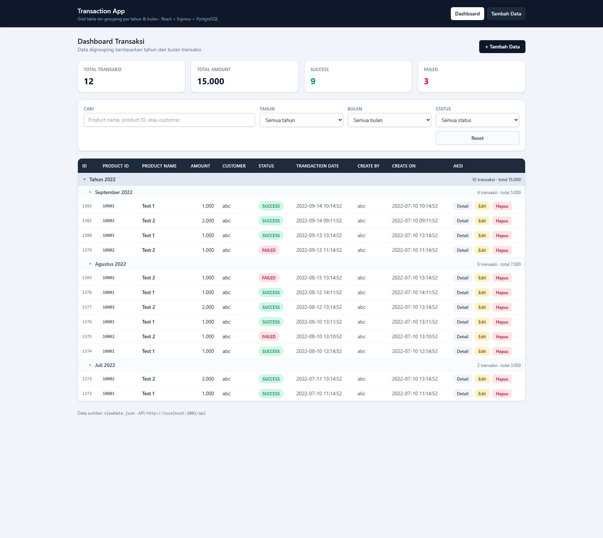
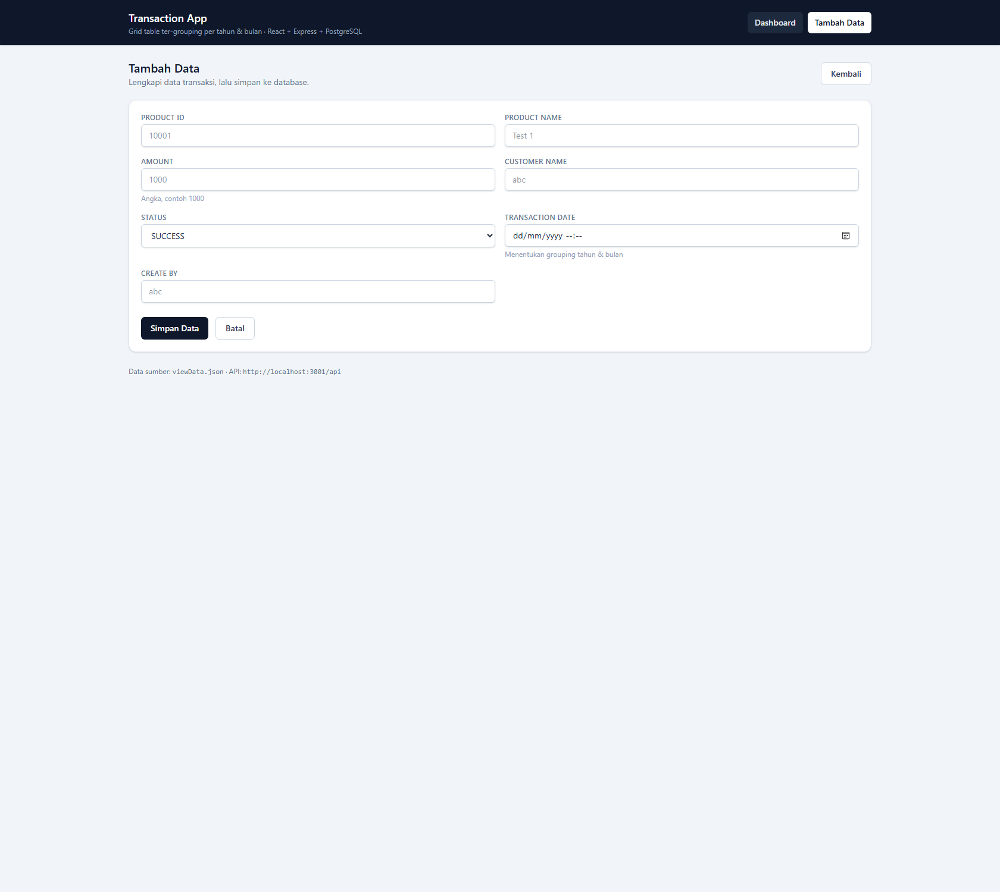
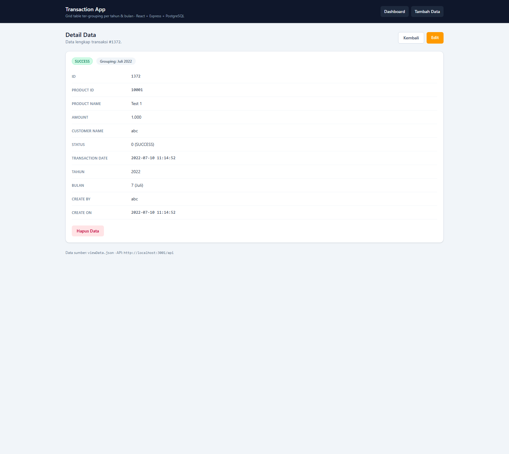
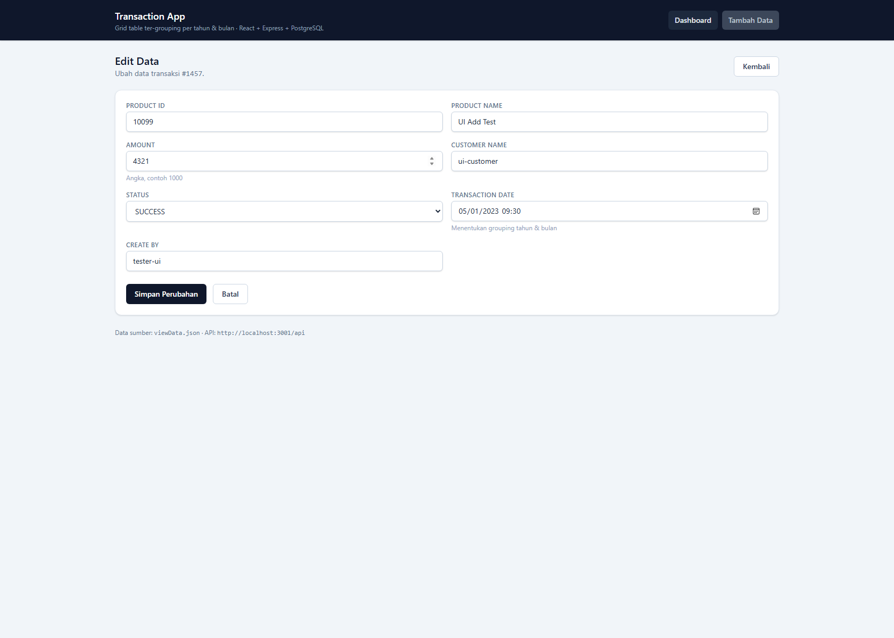
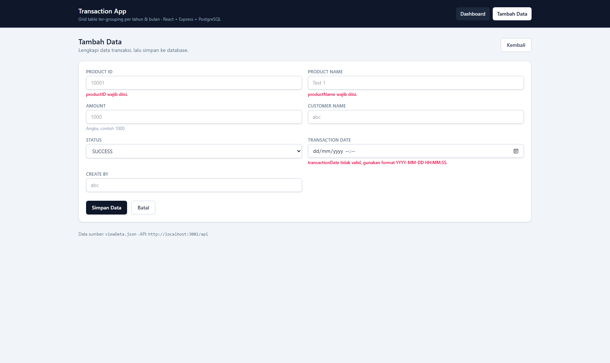
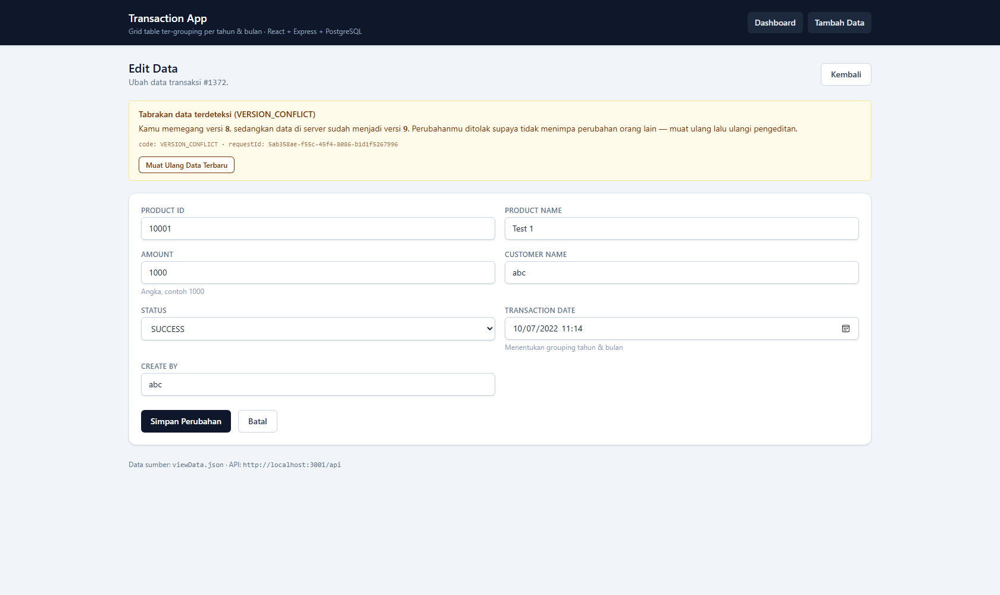
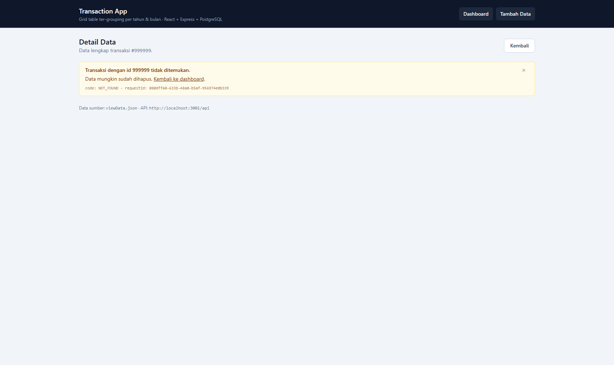
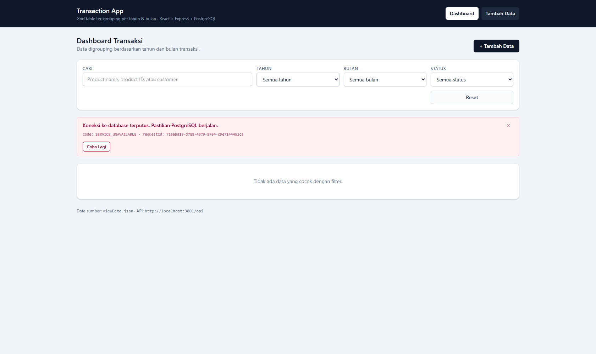

# Transaction App

Aplikasi web full stack untuk mengonsumsi `viewData.json`: data transaksi ditampilkan pada **grid table yang digrouping berdasarkan tahun & bulan** (collapsible), lengkap dengan **halaman Add / Edit / Detail**, REST API, dan database PostgreSQL.

## Demo



| Halaman | Tangkapan Layar |
| --- | --- |
| Tambah data |  |
| Detail data |  |
| Edit data |  |

Menjalankan demo lokal: `npm run db:up` &rarr; `npm install` &rarr; `npm run seed` &rarr; `npm run dev`, lalu buka **http://localhost:5173**.

## Stack

| Layer | Teknologi |
| --- | --- |
| Frontend | React 19 + Vite 8 + Tailwind CSS 4 + React Router 7 |
| API | Node.js + Express (REST/JSON) |
| Database | PostgreSQL 16 (Docker) |
| Driver | `pg` |
| E2E test | `puppeteer-core` (memakai Microsoft Edge yang terpasang) |

## Struktur

```
transaction-app/
├─ docker-compose.yml            # PostgreSQL 16 + healthcheck + volume
├─ viewData.json                 # data sumber (dari soal)
├─ .env.example
├─ scripts/
│  └─ e2e-smoke.mjs              # uji end-to-end UI di browser
├─ docs/screenshots/             # bukti demo
├─ server/
│  ├─ .env
│  └─ src/
│     ├─ index.js                # bootstrap Express + error handler
│     ├─ db.js                   # pool pg + loader schema
│     ├─ schema.sql              # DDL tabel, index, sequence
│     ├─ seed.js                 # import viewData.json -> PostgreSQL
│     ├─ mappers.js              # snake_case -> camelCase
│     ├─ validate.js             # validasi payload
│     └─ routes/
│        ├─ statuses.js
│        └─ transactions.js
└─ client/
   ├─ vite.config.js             # proxy /api -> :3001
   ├─ index.html
   └─ src/
      ├─ main.jsx / App.jsx
      ├─ api.js                  # wrapper fetch
      ├─ lib/format.js           # format angka, tanggal, nama bulan
      ├─ components/             # Layout, FilterBar, SummaryCards,
      │                          # GroupedTable, TransactionForm, StatusBadge
      └─ pages/                  # Dashboard, Add, Edit, Detail
```

## Halaman UI

| Route | Halaman | Fungsi |
| --- | --- | --- |
| `/` | Dashboard | Kartu ringkasan, filter (cari / tahun / bulan / status), **grid table digrouping Tahun &rarr; Bulan** yang bisa dilipat, aksi Detail/Edit/Hapus per baris |
| `/add` | Tambah Data | Form validasi, simpan via `POST`, lalu diarahkan ke halaman detail |
| `/edit/:id` | Edit Data | Form ter-prefill data lama, simpan via `PUT` |
| `/view/:id` | Detail Data | Semua field + badge status + info grouping (tahun, bulan), tombol Edit & Hapus |

Detail grid: header tahun menampilkan jumlah transaksi dan total amount; header bulan menampilkan hal yang sama; klik header untuk melipat/membuka grup.

## Prasyarat

- Node.js >= 20 (diuji pada v26.7.0)
- Docker Desktop (untuk PostgreSQL)

## Cara Menjalankan

> **Penting:** semua perintah dijalankan **di dalam folder `transaction-app/`** (folder yang berisi `package.json` ini). Kalau dijalankan dari folder induk, akan muncul `npm error Missing script: "dev"`.
>
> ```powershell
> cd "<path-ke-folder-transaction-app>"
> ```
>
> Atau tanpa pindah folder:
> ```powershell
> npm.cmd --prefix "<path-ke-folder-transaction-app>" run dev
> ```

```powershell
# 1. Nyalakan PostgreSQL
npm run db:up

# 2. Install dependency (root, server, client)
npm install

# 3. Konfigurasi (opsional, default sudah cocok dengan docker-compose)
Copy-Item .env.example server/.env

# 4. Import viewData.json ke database
npm run seed

# 5. Jalankan API (:3001) + UI (:5173) sekaligus
npm run dev
```

Buka **http://localhost:5173**.

> **Windows/PowerShell: `npm` diblokir ("running scripts is disabled")?**
> Itu kebijakan eksekusi PowerShell, bukan masalah aplikasi. Gunakan salah satu:
>
> ```powershell
> npm.cmd run dev                      # cara paling cepat
> cmd /c "npm run dev"                 # lewat cmd
> powershell -ExecutionPolicy Bypass -Command "npm run dev"   # per-perintah
>
> # atau aktifkan permanen untuk user ini (sekali saja):
> Set-ExecutionPolicy -Scope CurrentUser -ExecutionPolicy RemoteSigned
> ```

Perintah lain:

| Perintah | Fungsi |
| --- | --- |
| `npm run db:up` / `db:down` | Start / stop container PostgreSQL |
| `npm run db:reset` | Hapus volume + start ulang (database bersih) |
| `npm run db:logs` | Lihat log PostgreSQL |
| `npm run seed` | Import ulang `viewData.json` (idempotent, `ON CONFLICT`) |
| `npm run dev` | API + UI sekaligus (`concurrently`) |
| `npm run dev:server` | API saja, auto-reload |
| `npm run dev:client` | UI saja (Vite) |
| `npm run build` | Build produksi UI ke `client/dist` |
| `npm run test:e2e` | Uji end-to-end UI (butuh API + UI berjalan) |
| `npm run demo:errors` | Demo error handling + tabrakan data (output ke `docs/error-demo-output.txt`) |
| `npm run capture:errors` | Tangkap ulang screenshot UI error ke `docs/screenshots/errors/` |

## Skema Database

```sql
statuses (
  id    INTEGER PRIMARY KEY,
  name  TEXT NOT NULL UNIQUE
)

transactions (
  id                INTEGER PRIMARY KEY DEFAULT nextval('transactions_id_seq'),
  product_id        TEXT NOT NULL,
  product_name      TEXT NOT NULL,
  amount            NUMERIC(14,2) NOT NULL DEFAULT 0,
  customer_name     TEXT,
  status            INTEGER NOT NULL REFERENCES statuses(id),
  transaction_date  TIMESTAMP NOT NULL,
  create_by         TEXT,
  create_on         TIMESTAMP,
  created_at        TIMESTAMPTZ NOT NULL DEFAULT now(),
  updated_at        TIMESTAMPTZ NOT NULL DEFAULT now(),
  version           INTEGER NOT NULL DEFAULT 1
)
```

Kolom `version` dipakai untuk **optimistic locking**: setiap `PUT` menaikkannya, dan `PUT` dengan versi lama ditolak `409 VERSION_CONFLICT`.

Index: `transaction_date DESC`, `status`, dan index ekspresi `(date_part('year', ...), date_part('month', ...))` untuk grouping.

## REST API

Base URL: `http://localhost:3001/api`

| Method | Endpoint | Fungsi |
| --- | --- | --- |
| GET | `/` dan `/api` | Daftar endpoint yang tersedia |
| GET | `/error-catalog` | Daftar kode error yang mungkin muncul |
| GET | `/health` | Cek status API + database |
| GET | `/statuses` | Daftar status (`0 = SUCCESS`, `1 = FAILED`) |
| GET | `/transactions` | List datar + filter + paging |
| GET | `/transactions/grouped` | **Data ter-grouping tahun &rarr; bulan** (+ count & total amount) |
| GET | `/transactions/summary` | Ringkasan total / success / failed |
| GET | `/summary` | Alias dari `/transactions/summary` |
| GET | `/transactions/:id` | Detail 1 transaksi (+ info tahun, bulan, nama bulan) |
| POST | `/transactions` | Tambah data |
| PUT | `/transactions/:id` | Ubah data |
| DELETE | `/transactions/:id` | Hapus data |

Query param untuk `/transactions` dan `/transactions/grouped`:
`year`, `month` (1-12), `status` (0/1), `q` (cari di productName/productID/customerName), `page`, `pageSize`.

### Contoh

```bash
curl http://localhost:3001/api/transactions/grouped
curl "http://localhost:3001/api/transactions?year=2022&month=8&page=1&pageSize=10"
curl http://localhost:3001/api/transactions/1372

curl -X POST http://localhost:3001/api/transactions ^
  -H "Content-Type: application/json" ^
  -d "{\"productID\":\"10003\",\"productName\":\"Test Baru\",\"amount\":5000,\"customerName\":\"budi\",\"status\":1,\"transactionDate\":\"2023-01-15 09:30:00\",\"createBy\":\"tester\"}"

curl -X PUT http://localhost:3001/api/transactions/1384 ^
  -H "Content-Type: application/json" ^
  -d "{\"productID\":\"10003\",\"productName\":\"Test Baru (edit)\",\"amount\":7500,\"customerName\":\"budi\",\"status\":0,\"transactionDate\":\"2023-01-16 10:00:00\"}"

curl -X DELETE http://localhost:3001/api/transactions/1384
```

Respons error validasi (HTTP 400):

```json
{
  "errors": [
    { "field": "productID", "message": "productID wajib diisi." }
  ]
}
```

## Error Handling & Tabrakan Data

Semua error memakai satu format: `{ error, code, requestId, details?, errors? }`. Kode error stabil, log terstruktur ke console + `server/logs/app.log`, dan setiap respons error menyertakan `requestId` untuk pelacakan.

| Kelompok | Kode | HTTP |
| --- | --- | --- |
| Input | `VALIDATION_ERROR`, `MALFORMED_JSON`, `INVALID_ID`, `INVALID_STATUS`, `INVALID_INPUT` | 400 |
| Tidak ada | `NOT_FOUND`, `ENDPOINT_NOT_FOUND` | 404 |
| **Tabrakan data** | **`DUPLICATE_KEY`** (id sudah dipakai), **`VERSION_CONFLICT`** (record diubah pihak lain) | **409** |
| Lain-lain | `FOREIGN_KEY_VIOLATION`, `SERIALIZATION_FAILURE` | 409 |
| Server | `SERVICE_UNAVAILABLE`, `QUERY_TIMEOUT` | 503 |
| Server | `INTERNAL_ERROR` | 500 |

| Skenario | Tampilan UI |
| --- | --- |
| Validasi field |  |
| Tabrakan data saat edit |  |
| Data tidak ditemukan |  |
| Database mati (503) |  |

Demo live: `npm run demo:errors` (memicu 8 skenario + mencetak log), atau lihat hasil tersimpan di [`docs/error-demo-output.txt`](docs/error-demo-output.txt).

Dokumentasi lengkap (katalog kode, reproduksi 2-terminal, format log, 4 bug yang ditemukan saat pengujian): **[docs/ERROR-HANDLING.md](docs/ERROR-HANDLING.md)**.

## Catatan Penting Soal Data Sumber

`viewData.json` dari soal **bukan JSON valid**: terdapat *trailing comma* pada elemen terakhir array `data` (baris `},` tepat sebelum `],`).

- File asli **tidak diubah** agar tetap sesuai lampiran soal.
- Importer (`server/src/seed.js`) mem-parse dulu dengan `JSON.parse`; bila gagal, trailing comma dibersihkan otomatis dan menulis peringatan ke konsol.
- Hasil import: **2 status, 12 transaksi** (id 1372-1383, periode Juli-September 2022, total amount 15.000).

## Hasil Verifikasi

### Backend (curl / REST)

| Uji | Hasil |
| --- | --- |
| `GET /health` | `{"status":"ok","database":"up"}` |
| `GET /statuses` | SUCCESS (0), FAILED (1) |
| `GET /transactions/summary` | total 12, totalAmount 15000, success 9, failed 3 |
| `GET /transactions/grouped` | 2022 &rarr; September (4 / 5000), Agustus (6 / 7000), Juli (2 / 3000) |
| `GET /transactions/1372` | detail + `year 2022`, `month 7`, `monthName "Juli"` |
| `GET /transactions?page=1&pageSize=3` | meta `total 12`, `totalPages 4` |
| `POST /transactions` | 201, id baru, `createOn` terisi otomatis |
| `PUT /transactions/:id` | 200, data berubah |
| `DELETE /transactions/:id` | 204, lalu `GET` mengembalikan 404 |
| Validasi body kosong | 400 dengan daftar error per field |
| Status tidak terdaftar (9) | 400 `status 9 tidak terdaftar.` |

### Error Handling (`npm run demo:errors`)

| Skenario | HTTP | Kode |
| --- | --- | --- |
| Body kosong | 400 | `VALIDATION_ERROR` (+ 5 error per field) |
| JSON rusak | 400 | `MALFORMED_JSON` |
| `status: 9` | 400 | `INVALID_STATUS` |
| `GET id 999999` | 404 | `NOT_FOUND` |
| `GET id "abc"` | 400 | `INVALID_ID` |
| `POST id 1372` (sudah ada) | **409** | **`DUPLICATE_KEY`** |
| `PUT` dengan `version` lama | **409** | **`VERSION_CONFLICT`** (+ `details.current`) |
| Path tak terdaftar | 404 | `ENDPOINT_NOT_FOUND` |
| PostgreSQL dimatikan | **503** | **`SERVICE_UNAVAILABLE`** (API tetap hidup, pulih otomatis) |

### End-to-end UI (`npm run test:e2e`)

Diuji di browser headless (Microsoft Edge) terhadap UI + API + database sungguhan. **14/14 pemeriksaan lolos**:

```
PASS  Dashboard memuat grid table
PASS  Grouping bulan tampil (Juli, Agustus, September)
PASS  Summary cards tampil
PASS  Baris transaksi ter-render (12)
PASS  Filter bulan Agustus menyaring grid
PASS  Reset filter mengembalikan seluruh data
PASS  Add page menyimpan data baru (#1420)
PASS  Data baru masuk grouping Januari 2023
PASS  Amount tersimpan benar
PASS  Edit page ter-prefill data lama
PASS  Edit page mengganti nilai (bukan menambah)
PASS  Edit page menyimpan perubahan dan nama lama tidak tersisa
PASS  Hapus data berhasil dan grid ter-update
PASS  Tidak ada error runtime di browser
```

Data uji E2E selalu dibuat lalu dihapus kembali, sehingga database tetap berisi 12 transaksi asli. Build produksi juga lolos: `npm run build` &rarr; 36 modul, `dist/index.html` + CSS + JS.

## Share ke GitHub

Repo belum di-commit. Untuk mempublikasikan:

```bash
git init
git add .
git commit -m "feat: transaction app with grouped grid, CRUD, Express API and PostgreSQL"
git branch -M main
git remote add origin https://github.com/<username>/<repo>.git
git push -u origin main
```

`.gitignore` sudah mengecualikan `node_modules`, `dist`, dan file `.env`.

## Roadmap

- [x] Database PostgreSQL + schema + seed dari `viewData.json`
- [x] REST API CRUD, grouped, summary, filter, paging, validasi
- [x] UI React: grid table ter-grouping tahun & bulan (collapsible)
- [x] UI React: halaman Tambah / Edit / Detail + filter + ringkasan
- [x] Error handling terstruktur + katalog kode error + log JSON
- [x] Deteksi tabrakan data (`DUPLICATE_KEY`, `VERSION_CONFLICT` optimistic locking)
- [x] Demo: screenshot + uji E2E otomatis + demo error handling
